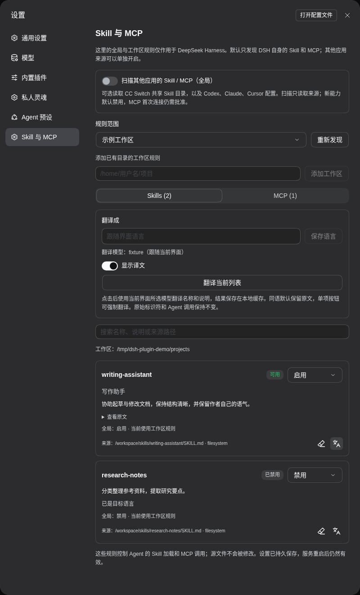
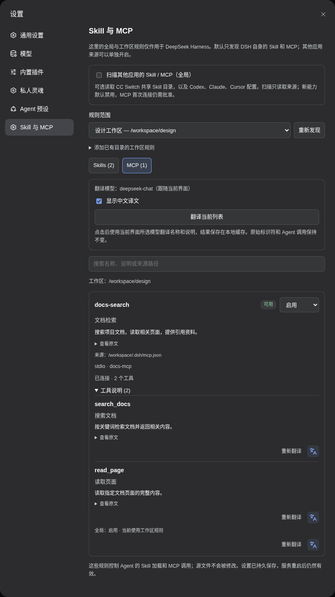

# DSH Capability Desk

[简体中文](README.md) | **English**

A Skill and MCP manager for DeepSeek Harness. Control available capabilities globally or per workspace, discover configured Skills and MCP servers, and translate names and descriptions using the current model.

Open **Settings → Skill 与 MCP (Skill & MCP)**. Package: `dsh-plugin-workspace-capabilities`.

The interface uses DSH native i18n and follows language changes immediately. Chinese and English dictionaries are included; other interface languages use the native English fallback.

## Features

- **Global and workspace rules:** inherit, enable, or disable individual capabilities. Workspace labels follow sidebar renames in real time.
- **Discovery:** scan DSH by default; optionally include CC Switch's shared Skills and Codex, Claude, or Cursor configurations.
- **Skill controls:** manage catalog visibility and content loading. Disabled items remain visible in settings.
- **MCP controls:** native stdio and Streamable HTTP clients, tools, resources, related prompts, connection status, and tool descriptions.
- **Chinese translations:** use the model selected in the current interface, or the default model when no session is selected. Cache by model and source text, switch to the original, or retranslate.
- **Persistent updates:** apply rules to subsequent calls with revision checks, hot-reload support, light/dark themes, and responsive layouts.

### Workspace rules and Skill translations

Select a scope, change each capability's rule, and toggle translated text using the bottom-right icon.



### MCP connections and tool descriptions

Inspect sources, connection status, and tool lists, and configure availability for each server.



## Installation

Compatible with DeepSeek Harness **0.2.1-rc.3 / 0.2.1-rc.5 / 0.2.2-rc.2** and Node.js **26**. Check interface compatibility before using another Harness version.

```bash
dsh plugin --profile web add https://github.com/ousiqwq/dsh-capability-desk/releases/download/v1.3.0/dsh-plugin-workspace-capabilities-1.3.0.tgz
```

Enable the plugin in DSH's plugin manager, restart DSH, refresh the page, and open **Settings → Skill 与 MCP**. Packages are also available from [Releases](https://github.com/ousiqwq/dsh-capability-desk/releases).

## Usage

1. Choose **全局默认 (Global defaults)** to configure defaults and individual capability rules.
2. Select a workspace and choose **继承全局 / 启用 / 禁用 (Inherit / Enable / Disable)**.
3. Enable **扫描其他应用的 Skill / MCP (Scan other applications)** when additional sources are needed.
4. Select **批准配置并启用连接 (Approve configuration and connect)** for newly discovered external MCP servers. Changed configurations require approval again.
5. Use the translation icon or **翻译当前列表 (Translate current list)**. **重新翻译 (Retranslate)** refreshes the cache.

Subagents use the root session's workspace rules. Changes do not require a new conversation, but cannot retract content already loaded into the model context. Ordinary file and terminal tools continue to follow DSH's own permissions.

## Discovery sources

Skills come from DSH's native providers. MCP sources include DSH configuration, `~/.dsh/mcp.json`, workspace `.dsh/mcp.json`, and the active tool registry. Example MCP JSON:

```json
{
  "mcpServers": {
    "example": {
      "command": "your-mcp-command",
      "args": []
    }
  }
}
```

Discovery reads source configurations; rules affect DSH. Turning off additional sources removes the associated Skill watchers and stops external MCP connections managed by this plugin. SSE and other applications' private OAuth state are not imported.

## Translation and storage

Translations use capability names and descriptions while retaining original identifiers and Agent calls. Viewing cached text does not trigger translation. Failed retranslations retain the previous result.

Data is stored in `$DSH_HOME/workspace-capabilities/`, or `~/.dsh/workspace-capabilities/` by default:

| File | Purpose |
| --- | --- |
| `policy.json` | Global/workspace rules, discovery options, and configuration approvals |
| `policy.json.bak` | Previous policy revision |
| `translations.json` | Translation cache |

## Development

```bash
npm ci --ignore-scripts
npm run check
npm test
npm pack
```

The plugin uses JavaScript ES Modules and needs no build step. See [TESTING.md](docs/TESTING.md) for browser checks.

## License

[MIT](LICENSE) © 2026 osiqwq

### Translation target

Enter a target in **Translate into**, or leave it blank to follow the DSH interface. The preference is persisted through native DSH settings. Source languages are detected automatically. Same-language items retain their original text by default; item translation and retranslation buttons force a fresh translation. The first classification uses the selected model; decisions and translations are cached by target, model, and source content. Opening settings and discovering capabilities do not call a model. Translated labels and descriptions only affect presentation, preserving Skill/MCP identifiers and calls.
