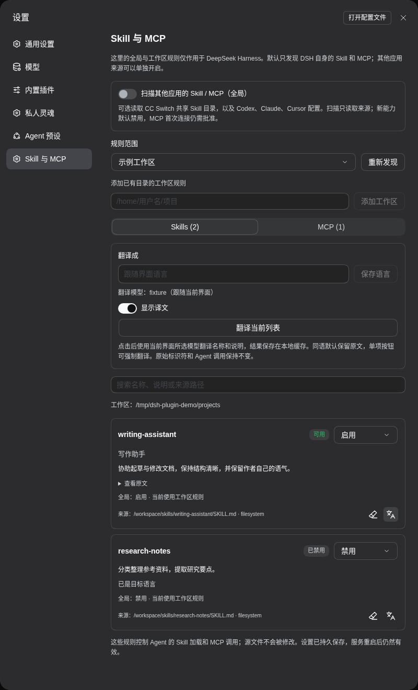
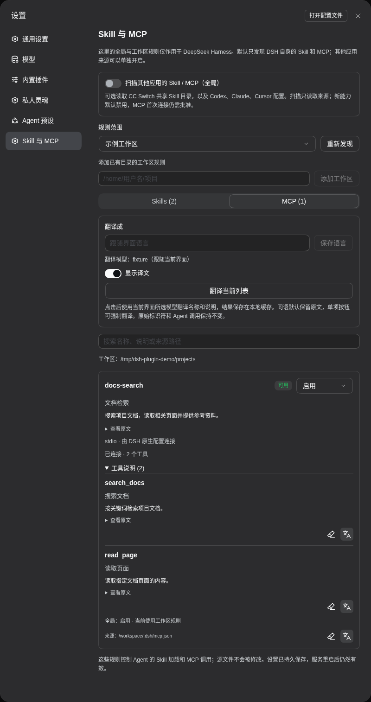

# DSH Capability Desk

**简体中文** | [English](https://github.com/ousiqwq/dsh-capability-desk/blob/main/README.en.md)

DeepSeek Harness 的 Skill 与 MCP 管理插件。按全局或工作区设置可用能力，发现已配置的 Skill/MCP，并使用当前模型翻译名称和说明。

入口：**设置 → Skill 与 MCP** · 插件包：`dsh-plugin-workspace-capabilities`

界面接入 DSH 原生 i18n，实时跟随 DSH 的语言设置。内置中英文词典；其他界面语言按 DSH 的规则回退到英文。

## 一键安装

兼容 DeepSeek Harness **0.2.1-rc.3 / 0.2.1-rc.5 / 0.2.2-rc.2**，Node.js **26**。

通过 **npx** 安装（Node.js 26，无需全局安装 dsh 或 pnpm）：

```bash
npx --yes --package=@deepseek-ai/dsh@0.2.2-rc.2 --package=pnpm@11.28.5 dsh plugin --profile web add dsh-plugin-workspace-capabilities@latest
```

在运行 DSH 的主机上，用原实例相同的账户和 `DSH_HOME` 执行。命令固定本轮验证的官方 DSH CLI，插件安装最新版；`web` 是目标 profile。已安装 DSH CLI 时也可使用：

```bash
dsh plugin --profile web add dsh-plugin-workspace-capabilities
```

在插件管理中启用插件，重启 DSH 并刷新页面，打开 **设置 → Skill 与 MCP**。

## Agent 预设兼容性

本轮在 DeepSeek Harness **0.2.2-rc.2** 的原生 Web 服务中，使用真实会话、工具执行器和文件接口逐项验证：

| 预设 | Capability Desk | Soul Desk | File Bridge |
| --- | --- | --- | --- |
| 标准 `standard` | Skill/MCP 规则、目录及调用拦截有效 | 三种注入方式、记忆与子代理规则有效 | 文件下载及权限校验有效 |
| PTC `ptc` | 可用 Skill 正常注入；启用的工具保留在 SDK 中，仅隐藏并拦截禁用项 | 保留 `run_code` 协议与工具 SDK，记忆可从 SDK 调用 | 同样有效，与工具调用形式无关 |
| 极简 `minimal` | 规则仍有效；不会额外添加 Skill 加载、编辑或子代理工具 | 人设与记忆有效，保留预设原有工具边界 | 同样有效 |
| 创造 `cordis` | Skill/MCP 规则有效，不移除原生创造工具 | 三种注入方式、记忆与子代理规则有效 | 同样有效 |

PTC 与标准模式都保留可用 Skill 目录、人设和记忆。Skill 完整说明仍在加载后进入上下文；PTC 通过 `run_code` 调用 SDK，标准模式直接调用工具。已实测两种模式与“优先／替换／追加”的六种组合，启用项可加载，禁用项不可强行调用。

极简模式没有原生 Skill 加载器或子代理，启用某项 Skill 不会为该预设补装这些工具。全局插件仍可提供自己的记忆或 MCP 工具。子代理策略以 Soul 的设置为准，默认不使用人设；复用派出者需明确配置。Soul 的“替换”模式替换预设提示词正文，但保留执行器协议/SDK、工具 schema 和原生运行上下文；希望保留原有任务说明时使用“优先”或“追加”。自定义预设若隔离或替换底层注册表、外部 ACP 后端，不在本次统一保证范围。

详见 [四模式验收](docs/AGENT-PRESET-COMPATIBILITY.md)。

## 功能

- **全局与工作区规则**：为每项能力选择继承、启用或禁用；工作区名称随侧边栏重命名实时更新。
- **能力发现**：默认扫描 DSH 自身；可选读取 CC Switch 共享 Skill 目录及 Codex、Claude、Cursor 配置。
- **Skill 控制**：管理能力目录与正文加载；禁用的项目仍保留在设置列表中。
- **MCP 控制**：支持原生 stdio / Streamable HTTP 客户端，管理工具、资源及相关提示词，查看连接状态和工具说明。
- **能力翻译**：目标语言可自定义，默认跟随界面；使用当前模型翻译并缓存，支持同语跳过和单项强制翻译。
- **即时保存**：规则用于后续调用，支持修订检查、热更新、深浅主题与窄屏。

### 工作区规则与 Skill 翻译

选择规则范围并单独调整能力状态。缓存译文默认显示；卡片右下角可去除或重新翻译。

截图使用当前 DSH 原生界面与隔离示例数据；设置区域为阅读方便展开显示。



### MCP 连接与工具说明

查看来源、连接状态与工具列表，为每个 MCP 设置可用规则。



## 使用

1. 选择 **全局默认**，设定新能力默认状态及各项能力的规则。
2. 选择工作区，设置 **继承全局 / 启用 / 禁用**。
3. 需要额外来源时，开启 **扫描其他应用的 Skill / MCP**。
4. 对新发现的外部 MCP 点击 **批准配置并启用连接**；配置发生变化后重新批准。
5. 在 **翻译成** 设置目标语言并点击 **保存语言**，留空跟随界面。
6. 有效缓存默认直接显示，无须点击，也不调用模型。单项只保留一个文字翻译图标，点击一次就用当前模型重新翻译并更新缓存，不区分中文或英文。只有 **翻译当前列表** 使用批量同语言跳过和缓存复用。**显示译文** 开关可临时切回原文，重新打开页面时仍默认显示缓存译文。

子 Agent 沿用根会话的工作区规则。修改不需要新建对话；已加载到模型上下文中的内容不会被撤回。普通文件与终端工具仍遵循 DSH 自身权限。

## 发现来源

Skill 由 DSH 的原生提供器发现。MCP 来源包括 DSH 配置、`~/.dsh/mcp.json`、工作区 `.dsh/mcp.json` 与当前工具注册表。MCP JSON 示例：

```json
{
  "mcpServers": {
    "example": {
      "command": "your-mcp-command",
      "args": []
    }
  }
}
```

扫描读取来源配置；规则只影响 DSH。关闭额外来源会移除相关 Skill 监听，并停止本插件管理的外部 MCP 连接。SSE 与其他应用的私有 OAuth 状态不在导入范围内。

## 翻译与存储

在“翻译成”填写目标语言，留空跟随 DSH 界面；设置通过 DSH 原生配置接口持久保存。模型实时跟随 DSH 当前会话的原生模型状态，发起请求时重新读取；旧会话保留的模型已不在可用目录时，翻译使用 DSH 当前默认模型并显示说明，不修改会话选择。批量翻译自动判断原语言，同语内容可保留原文；单项按钮始终强制重新翻译。缓存显示按原文和目标语言识别，不因切换模型失效；原有模型相关记录保留，旧缓存可按 DSH 历史模型信息补建显示索引。打开设置、切换模型或发现列表不会自动调用模型。名称和说明的译文仅用于显示，Skill/MCP 标识符和调用保持原样。

翻译使用能力名称与说明，保留原始标识符和 Agent 调用方式。已有缓存时切换显示不发起新的翻译；重新翻译失败会保留旧译文。

数据位于 `$DSH_HOME/workspace-capabilities/`，默认 `~/.dsh/workspace-capabilities/`：

| 文件 | 用途 |
| --- | --- |
| `policy.json` | 全局与工作区规则、来源选项、配置批准记录 |
| `policy.json.bak` | 上一版策略 |
| `translations.json` | 译文缓存 |

单项右侧提供“去除翻译”和“重新翻译”两个图标：去除仅清除此项当前目标语言的缓存并恢复原文；重新翻译单击即调用当前模型。翻译任务最多并发 8 项，超出的自动排队，可在处理中继续添加其他条目；失败不会阻塞后续任务。缓存仍默认显示。

## 开发

```bash
npm ci --ignore-scripts
npm run check
npm test
npm pack
```

项目使用 JavaScript ES Modules，无需编译。浏览器检查命令见 [TESTING.md](https://github.com/ousiqwq/dsh-capability-desk/blob/main/docs/TESTING.md)。

## 许可证

[MIT](https://github.com/ousiqwq/dsh-capability-desk/blob/main/LICENSE) © 2026 osiqwq
